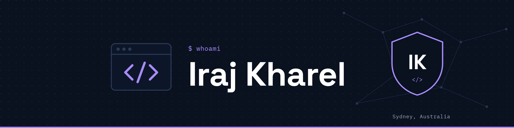

$ whoami

Final-year Bachelor of IT student in Sydney, building towards a career in cybersecurity.
I don't stop at "it works" — I want to understand why it works and how it could break.

# Security
- Wazuh SIEM/XDR lab on Ubuntu Server (ARM64)
- Web app pen testing: DVWA, OWASP Juice Shop
- Currently learning: Splunk

#Projects
- **SheaMart**: secure retail order management system (capstone)
- **Sunkhani Pahuna Ghar Resort**: bilingual React + Firebase booking website

# Connect
[LinkedIn](www.linkedin.com/in/irajkharel)
